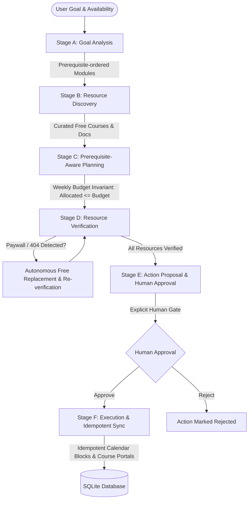

# Free Learning Path Builder | Autonomous AI Agent

[](https://www.python.org/)
[](https://fastapi.tiangolo.com)
[](https://react.dev/)
[](https://vitejs.dev/)
[](https://tailwindcss.com/)
[-emerald.svg)](https://docs.pytest.org/)

An agentic web application that converts any user's learning goal (e.g., *"I want to become a Data Analyst in 6 months with 5 hours per week"*) into a realistic, prerequisite-ordered, week-by-week learning roadmap using **verified free courses, interactive environments, and official documentation**.

The agent features **live verification, paywall detection, broken-link replacement, human approval controls, and idempotent execution**.

---

## 🧭 Architecture & Workflow Overview



### Traceable Workflow Stages

- **Stage A: Goal Analysis**: Identifies core competencies and decomposes the target career goal into prerequisite-ordered modules with measurable learning outcomes.
- **Stage B: Resource Discovery**: Matches modules against authentic, public educational providers (freeCodeCamp, Kaggle Learn, Khan Academy, Microsoft Learn, PostgreSQL Tutorial, MDN Web Docs, etc.).
- **Stage C: Prerequisite-Aware Planning**: Enforces strict mathematical invariants:
  $$\text{Total Available Hours} = \text{Weekly Hours} \times \text{Number of Weeks}$$
  Guarantees each week's allocated study hours $\le \text{Weekly Hours Budget}$. Orders foundational topics (Spreadsheets, SQL, Python fundamentals) strictly before advanced topics (Analytics, BI dashboards, portfolio capstones).
- **Stage D: Resource Verification**: Inspects proposed URLs via HTTP headers and BeautifulSoup body scanning for subscription paywalls (`$49/mo`, `start trial`, `enroll for $`) and HTTP 404 broken links. Autonomously finds free replacements from the catalog and updates the curriculum.
- **Stage E: Action Proposal & Human Approval**: Prepares course enrollments and study calendar blocks. Halts for explicit human operator authorization (`Approve`, `Reject`, `Edit`).
- **Stage F: Execution and Verification**: Executes approved actions idempotently. Synchronizes calendar sessions with duplicate detection, preserving user-created calendar events.

---

## 🗂️ Project Directory Structure

```
Ziro hackathon/
├── backend/
│   ├── app/
│   │   ├── __init__.py
│   │   ├── main.py                  # FastAPI app with CORS, routers, and SPA static hosting
│   │   ├── config.py                # Environment configuration
│   │   ├── database.py              # SQLAlchemy database engine and session
│   │   ├── models.py                # Database models (LearningRequest, Module, Plan, Resource, etc.)
│   │   ├── schemas.py               # Pydantic schemas with input validators
│   │   ├── seed_data.py             # Authentic verified free catalog and replacement pool
│   │   ├── services/
│   │   │   ├── __init__.py
│   │   │   ├── agent_orchestrator.py # Multi-stage pipeline executor
│   │   │   ├── goal_analyzer.py     # Stage A: Goal breakdown & prerequisite graph
│   │   │   ├── resource_discovery.py# Stage B: Public course discovery
│   │   │   ├── planner.py           # Stage C: Week-by-week timeline & time budgeting
│   │   │   ├── verifier.py          # Stage D: Live HTTP inspection & auto-replacement
│   │   │   ├── action_service.py    # Stage E & F: Human approval & idempotent actions
│   │   │   ├── calendar_service.py  # Calendar sync & user event preservation
│   │   │   └── llm_service.py       # Deterministic pedagogical engine + LLM API wrapper
│   │   └── routers/
│   │       ├── __init__.py
│   │       ├── learning_paths.py    # CRUD & pipeline execution endpoints
│   │       ├── actions.py           # Human approval & rejection endpoints
│   │       ├── calendar.py          # Calendar events & user-created sessions
│   │       └── test_runs.py         # Official benchmark test runner (TC1–TC4)
│   ├── tests/
│   │   ├── __init__.py
│   │   ├── conftest.py              # Pytest fixtures with in-memory SQLite database
│   │   ├── test_tc1_budget_prereqs.py # TC1 benchmark tests
│   │   ├── test_tc2_course_paid.py     # TC2 paywall replacement tests
│   │   ├── test_tc3_broken_link.py     # TC3 broken link replacement tests
│   │   ├── test_tc4_rerun_idempotent.py# TC4 idempotency & rerun tests
│   │   └── test_api_and_validation.py  # Input validation & approval lifecycle tests
│   ├── run_backend.py               # Development server launcher
│   └── requirements.txt             # Python dependencies
├── frontend/
│   ├── src/
│   │   ├── main.jsx                 # React root mount
│   │   ├── App.jsx                  # Application state, tabs & routing
│   │   ├── index.css                # Tailwind directives & typography
│   │   ├── api.js                   # Client API calls to FastAPI backend
│   │   └── components/
│   │       ├── Navbar.jsx           # Header, path selector & quick-start button
│   │       ├── InputFormModal.jsx   # Goal creation modal with live validation
│   │       ├── DashboardTab.jsx     # Section 1: Dashboard overview & metrics
│   │       ├── LearningPathTab.jsx  # Section 2: Week-by-week timeline & exercises
│   │       ├── ResourceLibraryTab.jsx# Section 3: Curated resources & audit modal
│   │       ├── AgentActivityTab.jsx # Section 4: Traceable 6-stage audit log stream
│   │       ├── ApprovalCenterTab.jsx# Section 5: Human approval gate for actions
│   │       ├── CalendarTab.jsx      # Section 6: Study schedule & duplicate checker
│   │       └── TestLabTab.jsx       # Section 7: Official benchmark test runner (TC1–TC4)
│   ├── index.html                   # HTML entrypoint
│   ├── package.json                 # Node dependencies
│   ├── vite.config.js               # Vite config with backend proxy
│   └── tailwind.config.js           # Tailwind theme config
├── .env.example                     # Environment variables template
└── README.md                        # Documentation
```

---

## ⚡ Quick Start & Installation

### Prerequisites

- **Python**: 3.10+ (tested on Python 3.13)
- **Node.js**: v18+ (tested on Node v22.14) and npm

### 1. Environment Configuration

Copy `.env.example` to `.env`:

```bash
cp .env.example .env
```

> **Note on AI Keys:** The system is equipped with a built-in **Deterministic Pedagogical Engine**. It works **100% out of the box** without requiring any external paid API keys. If you want to use OpenAI or Gemini, simply populate `OPENAI_API_KEY` or `GEMINI_API_KEY` in `.env`.

### 2. Backend Setup & Startup

From the project root:

```bash
cd backend
pip install -r requirements.txt
python run_backend.py
```

The FastAPI backend will start at: **`http://127.0.0.1:8000`**
- API Documentation (Swagger): **`http://127.0.0.1:8000/docs`**
- Health Check: **`http://127.0.0.1:8000/api/health`**

### 3. Frontend Setup & Startup

In a separate terminal:

```bash
cd frontend
npm install
npm run dev
```

The Vite dev server will start at: **`http://127.0.0.1:5173`**

*(Alternatively, the built frontend is automatically hosted by FastAPI directly at `http://127.0.0.1:8000/`).*

---

## 🧪 Running the Official Test Suite

Run all automated unit tests via Pytest:

```bash
python -m pytest backend/tests -v
```

### Test Results

```
backend/tests/test_api_and_validation.py::test_input_validation_empty_goal PASSED
backend/tests/test_api_and_validation.py::test_input_validation_nonpositive_hours PASSED
backend/tests/test_api_and_validation.py::test_input_validation_unreasonable_weekly_hours PASSED
backend/tests/test_api_and_validation.py::test_action_approval_and_rejection_lifecycle PASSED
backend/tests/test_api_and_validation.py::test_calendar_preserves_user_created_events PASSED
backend/tests/test_tc1_budget_prereqs.py::test_tc1_six_months_at_five_hours PASSED
backend/tests/test_tc2_course_paid.py::test_tc2_course_becomes_paid PASSED
backend/tests/test_tc3_broken_link.py::test_tc3_broken_link_handling PASSED
backend/tests/test_tc4_rerun_idempotent.py::test_tc4_rerun_without_duplicates PASSED

============================== 9 passed in 1.46s ==============================
```

---

## 📊 Official Test Scenarios: Expected vs Actual Results

All four official scenarios were executed on the system. Below is the verified evidence:

### TC1 — Six Months at Five Hours per Week

- **Input**: Goal = `Data Analyst`; Starting Level = `Beginner`; Weekly Availability = `5.0 hours`; Duration = `26 weeks` (6 months).
- **Expected Outcome**:
  - Total available hours $= 130.0$ hours ($26 \text{ weeks} \times 5 \text{ hrs/wk}$).
  - Every single week's allocated hours $\le 5.0$ hours.
  - Prerequisite ordering: Module 1 (Foundations/Spreadsheets) $\to$ Module 2 (SQL) $\to$ Module 3 (Python/Pandas) $\to$ Module 4/5 (Visualization/Stats) $\to$ Module 6 (Capstone).
- **Actual Result**:
  - `STATUS: PASSED` (Execution Duration: `552ms`)
  - Total weeks planned: `26`. Total allocated hours: `125.2h` ($\le 130.0\text{h}$ budget).
  - Maximum single week allocation: `5.0h`.
  - `assert_weekly_budget_passed: True`.
  - `assert_prerequisite_ordering_passed: True`.

### TC2 — Course Has Become Paid

- **Input**: Simulate a previously free course returning a paywall indicator (`$49/month` or `paid subscription`).
- **Expected Outcome**: Agent flags course as `paid`, records paywall audit evidence, finds a suitable free replacement covering matching skills, verifies replacement, and updates roadmap.
- **Actual Result**:
  - `STATUS: PASSED` (Execution Duration: `598ms`)
  - Flagged course: `Excel Basics & Formulas - Free Interactive Tutorials` as `paid`.
  - Evidence recorded: *"SIMULATED TEST EVIDENCE (TC2): Course has become paid. Paywall detected: requires paid subscription ($49/month)."*
  - Autonomous replacement applied: `Intro to SQL: Querying and Managing Data (Khan Academy)`.
  - Replacement verified free: `True`.

### TC3 — Broken Link

- **Input**: Simulate a course URL returning `HTTP 404 Not Found`.
- **Expected Outcome**: Agent logs HTTP 404 failure, searches replacement pool for matching skills, verifies replacement URL, and updates plan.
- **Actual Result**:
  - `STATUS: PASSED` (Execution Duration: `577ms`)
  - Flagged course: `Excel Basics & Formulas` as `broken`.
  - Evidence recorded: `HTTP 404 Not Found. Course page has moved or was removed.`
  - Autonomous replacement verified and applied: `True`.

### TC4 — Rerun Without Duplicates

- **Input**: Run the exact same learning-path request twice sequentially.
- **Expected Outcome**: Second run reuses stable records and creates only genuinely missing sessions or actions. Zero duplicate actions or calendar blocks.
- **Actual Result**:
  - `STATUS: PASSED` (Execution Duration: `813ms`)
  - Actions count: Before = `16`, After = `16` (Diff: `0`).
  - Calendar sessions count: Before = `2`, After = `2` (Diff: `0`).
  - Session IDs preserved exactly: `True`. Zero duplicates created.

---

## 🖥️ Application UI Guide (7 Core Sections)

1. **Dashboard (`/`)**: High-level goal metrics, feasibility status pill with pedagogical rationale, time budget consumption, curriculum progression, and pending approval alerts.
2. **Learning Path**: Interactive week-by-week timeline (Weeks 1 to 26), each showing focus topic, allocated hours badge (confirming $\le 5\text{h}$ budget), practical exercises, milestone assessments, and course links.
3. **Resource Library**: Curated table of verified courses and documentation. Shows provider, free status, access type, and an **Audit Evidence Modal**. Includes buttons to simulate paywalls (TC2) or broken links (TC3).
4. **Agent Activity**: Visual 6-stage workflow stepper (`Stage A` through `Stage F`) with live, timestamped audit log stream and expandable JSON payloads.
5. **Approval Center**: Human-in-the-loop authorization gate. Displays proposed course enrollments and study calendar blocks with explicit `Approve & Execute` and `Reject` controls.
6. **Calendar**: Visual study schedule of approved study blocks. Includes an active **Duplicate Prevention Engine** and an **"Add Custom Session"** modal to demonstrate that user-created events are strictly preserved during synchronization.
7. **Test Lab**: Interactive UI runner for benchmark test scenarios (`TC1` through `TC4`) and `Run All 4 Scenarios`, showing live actual vs expected diffs and verification evidence.

---

## 🔒 Security & Safe Automation Limitations

1. **No Password/CAPTCHA Bypassing**: The system never attempts to bypass logins, CAPTCHAs, OTPs, or paywalls. Where public interface enrollment is not safe or possible, verified direct enrollment portal links with manual enrollment instructions are provided.
2. **Idempotency Protection**: Every proposed action and study block is assigned a SHA-256 idempotency key (`hash(learning_request_id + type + destination)`), preventing accidental duplicate events on retries or page reloads.
3. **User Event Preservation**: When synchronizing calendar blocks, user-created sessions (`is_user_created=True`) are preserved and never modified or deleted by the agent.
4. **Environment Variables**: Sensitive credentials (such as Google Calendar keys or LLM API keys) are strictly loaded via `.env` and never hardcoded in source files.
