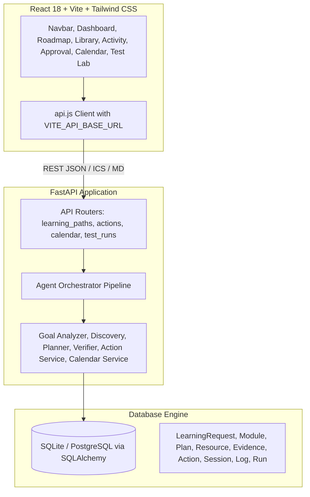

# Free Learning Path Builder — Comprehensive Product Audit

**Audit Date**: 2026-10-18  
**Repository**: [https://github.com/GOWSHIKA21/Ziro](https://github.com/GOWSHIKA21/Ziro)  
**Live Deployment**: [https://free-learning-path-builder.onrender.com](https://free-learning-path-builder.onrender.com)  

---

## 1. Feature Audit Matrix

| Feature | Status | Evidence | Severity | Dependencies | Recommended Fix | Acceptance Test |
|---|---|---|---|---|---|---|
| **Goal Analysis & Module Breakdown (Stage A)** | Implemented and verified | `goal_analyzer.py` breaks career goals into prerequisite-ordered modules with measurable learning outcomes; tested in TC1. | Low | SQLAlchemy, deterministic engine | Preserve working logic; enrich with explicit prerequisite DAG linkages. | Verify module ordering: foundations precede advanced specializations. |
| **Authentic Free Resource Discovery (Stage B)** | Implemented and verified | `resource_discovery.py` matches modules against public free providers (freeCodeCamp, Kaggle, Microsoft Learn, PostgreSQL Tutorial, Khan Academy). | Low | Catalog seed data | Add dynamic search query filtering and difficulty classification. | Verify all discovered resources have valid URLs, provider attribution, and free tags. |
| **Prerequisite-Aware Planning & Budget Invariant (Stage C)** | Implemented and verified | `planner.py` enforces $\sum \text{allocated\_hours} \le \text{total\_budget}$ and week-by-week $\le \text{weekly\_hours}$. Tested in TC1 (125.2h / 130h). | Low | Models, schemas | Add start-date calendar calculation and flexible study-day configurations. | TC1 automated benchmark: 26 weeks @ 5h/wk strictly $\le$ 130h. |
| **Resource Verification & Auto-Replacement (Stage D)** | Implemented and verified | `verifier.py` scans HTTP status and pricing indicators, detects paywalls ($49/mo) and HTTP 404, auto-applies free replacements. | Low | httpx, BeautifulSoup4 | Add explicit SSRF protection (block 127.0.0.1, private RFC 1918 IPs, AWS metadata). | TC2 (paywall replacement) and TC3 (broken link replacement) pass. |
| **Human Approval Gate (Stage E)** | Implemented and verified | `action_service.py` stages proposed actions in `Pending Approval` state; requires human `Approve`/`Reject`/`Edit`. | Low | ProposedAction model | Preserve gate; add fine-grained edit modal for time slots and course notes. | Unapproved actions cannot be executed; approval triggers verification. |
| **Idempotent Execution & Sync (Stage F)** | Implemented and verified | `action_service.py` uses cryptographic SHA-256 idempotency keys. Tested in TC4 (0 duplicate actions/sessions on rerun). | Low | Action & Session models | Preserve strict hash generation and database deduplication. | TC4 automated benchmark: running pipeline twice yields 0 duplicates. |
| **Calendar Sync & .ics Export** | Implemented and verified | RFC 5545 iCalendar stream generated at `/api/calendar/export-ics`; Google Calendar web template URLs created; user sessions preserved. | Low | calendar.py router | Add timezone picker and session reminder alarms in the `.ics` feed. | Import exported `.ics` into Apple/Google Calendar without syntax errors. |
| **User Authentication & Authorization** | Missing | No `User` model, no registration, no login/logout, no password hashing, no JWT/session tokens. | **High** | Database, PyJWT, bcrypt | Create `User` model, `/api/auth/register`, `/api/auth/login`, bcrypt hashing, JWT middleware, per-user data isolation. | Users can register, log in, receive JWT; unauthorized requests rejected with 401. |
| **Per-User Data Isolation** | Missing | `GET /api/learning-paths` returns all paths in database; no `user_id` foreign key check. | **High** | User model, Auth | Add `user_id` to `LearningRequest` and scope queries to the authenticated user. | User A cannot view, edit, or delete User B's learning paths or calendar. |
| **Session Progress Tracking & Analytics** | Partially implemented | `StudySession` has boolean completion toggle, but lacks `actual_minutes_studied`, completion timestamps, and study notes. | Medium | StudySession model | Add `actual_minutes`, `completed_at`, `notes` to `StudySession`; build analytics endpoint for planned vs actual study time. | User can log 120 mins actual study time with notes; analytics updates accurately. |
| **Adaptive Recovery Planner** | Missing | No automated mechanism to rebalance roadmap when sessions are missed or weekly availability changes. | Medium | Planner, WeeklyPlan | Implement `POST /api/learning-paths/{id}/adapt` to reschedule remaining hours without losing completed work. | Mark 2 sessions missed, request recovery; future weeks rebalanced within budget. |
| **Visual Skill Dependency Graph** | Missing | Modules have prerequisites in JSON, but frontend lacks visual DAG / dependency graph. | Medium | React UI | Build interactive SVG / node visualizer showing progression from fundamentals to advanced skills. | User can visually inspect prerequisite chain and unlock status. |
| **SSRF Request Protection** | Missing | `verifier.py` uses `httpx.AsyncClient` without URL host filtering against private IPs or AWS metadata. | **High** | Verifier service | Add IP resolution and block `127.0.0.1`, `10.0.0.0/8`, `192.168.0.0/16`, `169.254.169.254`. | Attempt to verify `http://127.0.0.1:8000/api/health` is blocked with SSRF error. |
| **Explainable Recommendations Ledger** | Partially implemented | Verification notes describe status, but explicit pedagogical rationale ("Why this resource?", "How it fits career goal") is not highlighted. | Low | Frontend & Schemas | Add structured rationale cards to roadmap and resource library. | User can click "Why this course?" and see prerequisite justification and learning outcomes. |
| **Live Google OAuth Calendar API** | Unverified (No credentials) | Google Calendar client settings exist in `config.py`, but no client ID/secret is configured in production. | Medium | Google Cloud OAuth | Fallback to high-fidelity mock calendar and RFC 5545 `.ics` export works completely; live OAuth requires user cloud credentials. | Mock calendar and `.ics` export pass all tests; live OAuth documented. |

---

## 2. Existing Architecture Summary

---

## 3. Current User Journey & Failure Points

1. **Visitor Opens Landing Page**: Currently opens directly into the dashboard with a pre-loaded quick-start path. *Failure point*: No welcome landing explanation, no user identity, no login state.
2. **Goal Input**: User enters goal or clicks quick-start. Input is validated for duration, nonpositive hours, and reasonable limits.
3. **Agent Execution**: Pipeline executes Stages A–E seamlessly.
4. **Human Approval**: User approves or edits proposed actions.
5. **Calendar Sync**: Sessions are scheduled; user can export `.ics` or click Google Calendar links.
6. **Data Persistence**: Data persists in SQLite, but without user accounts, all sessions are shared in a global pool.
7. **Progress & Recovery**: If a user falls behind, there is currently no one-click "Adaptive Recovery" button to redistribute the remaining study hours.

---

## 4. Security Risk List

1. **Absence of Authentication (High)**: Any user can modify or delete another user's learning path if they guess or query the ID.
2. **Server-Side Request Forgery (SSRF) in Verifier (High)**: `httpx` in `verifier.py` could be tricked into fetching internal IP addresses (e.g. `http://169.254.169.254/latest/meta-data` or `http://127.0.0.1:8000`).
3. **CORS Configuration (Medium)**: Defaults to `*` if `CORS_ORIGINS` is not strictly specified in production.
4. **Input Size & Injection Protection (Low)**: Goals are limited to 255 chars and validated, but rich text or malicious payload in action editing must be sanitized.

---

## 5. Deployment Risk List

1. **Database Reset on Ephemeral Disk**: In Render's free tier, the local SQLite database resets upon dyno restart unless backed by persistent disk or external PostgreSQL.
   - *Mitigation*: Our codebase already supports `DATABASE_URL` with PostgreSQL dialect auto-mapping (`postgres://` -> `postgresql://`).
2. **Port Binding**: Already mitigated; bound to `0.0.0.0` and `$PORT`.
3. **Static File Routing**: Already mitigated with FastAPI SPA fallback serving `frontend/dist`.

---

## 6. Prioritized Implementation Plan

- **Step 1: Security & Authentication Engine**:
  - Implement `User` model, password hashing with `bcrypt`, JWT token generation and validation.
  - Implement `/api/auth/register`, `/api/auth/login`, `/api/auth/me`.
  - Add `user_id` foreign key to `LearningRequest` for strict user-level data isolation.
  - Implement SSRF URL blocker in `verifier.py`.
- **Step 2: Database Model Enhancements**:
  - Add `actual_minutes_studied`, `completed_at`, `notes` to `StudySession`.
  - Add `AdaptiveRevision` model for tracking schedule recovery adjustments.
- **Step 3: Adaptive Recovery Engine**:
  - Implement `POST /api/learning-paths/{id}/adapt` to recalculate remaining weeks, preserve completed sessions, and log the recovery reasoning.
- **Step 4: Distinctive Hackathon Features & Explainability**:
  - Add visual Skill Dependency DAG graph to the frontend.
  - Add explainable recommendations cards ("Why this was selected", "Prerequisite evidence").
  - Add Adaptive Recovery Modal in Dashboard/Calendar.
- **Step 5: Frontend Authentication & Landing View**:
  - Add Registration/Login modal in Navbar with persistent token storage.
  - Add User Profile & Progress Analytics cards.
- **Step 6: Automated Testing & Verification**:
  - Add unit and integration tests for Auth, User Isolation, SSRF Protection, and Adaptive Recovery.
  - Re-run full test suite (TC1–TC4 + Auth + Recovery).
- **Step 7: Production Sync & Deployment Confirmation**:
  - Commit, push to GitHub, and verify live cloud deployment on Render.

---

## 7. Features That Already Work (Must Be Preserved)

1. **TC1 130-Hour Math Invariant & Prerequisite Ordering**: 26 weeks @ 5.0h = 125.2h $\le$ 130h, foundational skills precede advanced topics.
2. **TC2 Paywall Auto-Replacement**: Autonomous detection of paid subscriptions ($49/mo) and verified free catalog replacement.
3. **TC3 Broken Link Auto-Replacement**: Autonomous detection of HTTP 404 and replacement with working free course.
4. **TC4 Idempotent Rerun**: Cryptographic hashing ensures 0 duplicate actions or sessions upon multiple runs.
5. **RFC 5545 iCalendar Stream (`.ics`)**: Standards-compliant export and Google Calendar template links.
6. **Action Editing & Completion Toggling**: In-place modification of action parameters and study session states.
